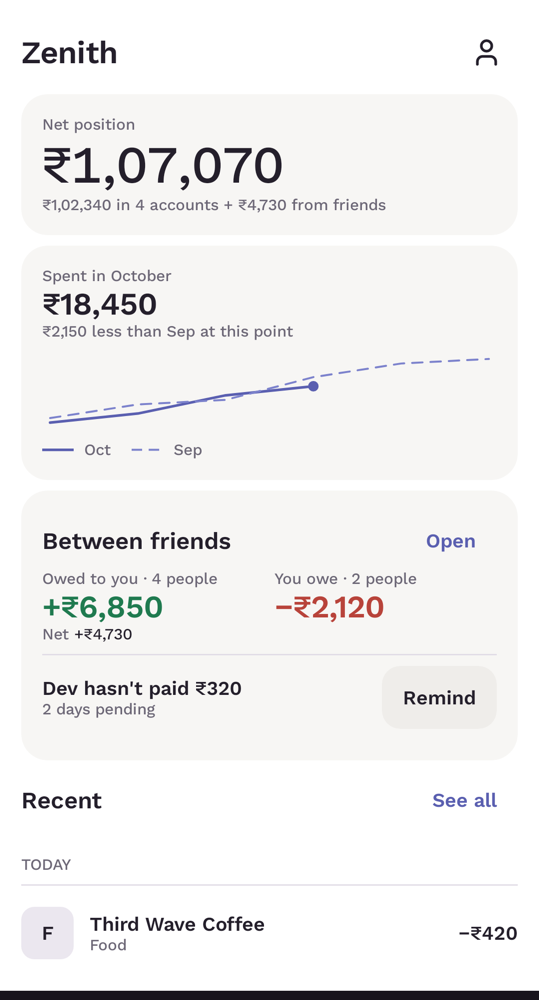
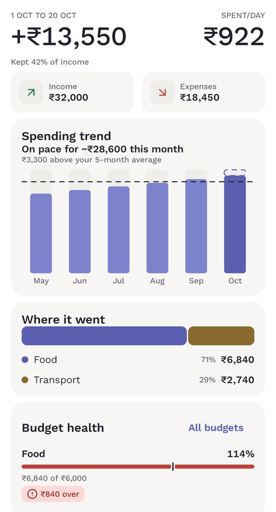
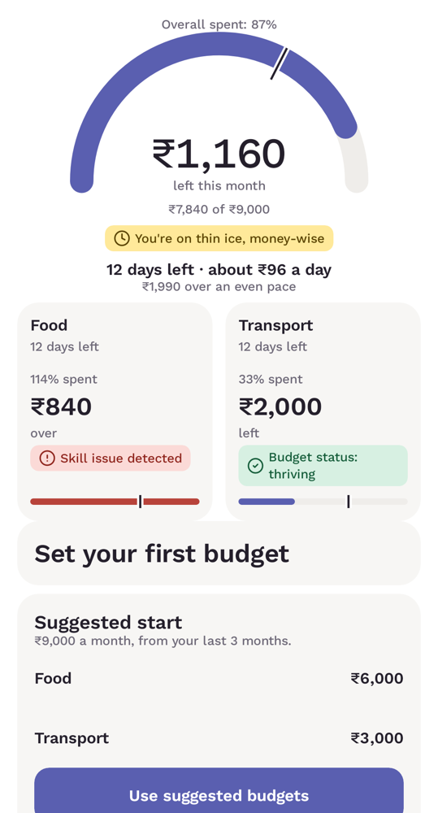
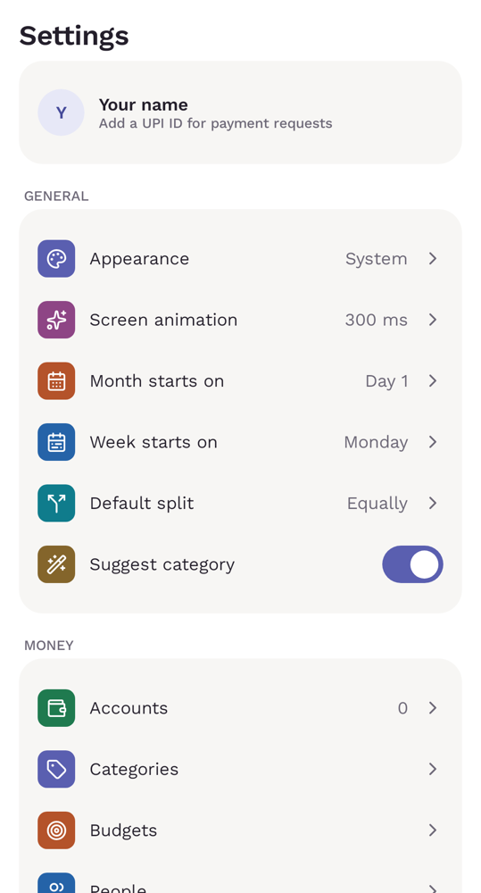

# Zenith

An offline personal money tracker for Android: spending, income, budgets and who owes whom.
Everything stays on the device. There is no account and no internet permission.

| Overview | Insights | Budgets | Settings |
|---|---|---|---|
|  |  |  |  |

See [CHANGELOG.md](CHANGELOG.md) for what is in each release.

## Build

Needs JDK 21 and the Android SDK (platform 36.1). Android 12 or newer to run.

```bash
./gradlew testDebugUnitTest
```

```bash
./gradlew assembleDebug
```

Debug builds add **Settings > Debug > Add random test data**. It is not compiled into release builds.

### Versions
`version.properties` holds `major` and `minor`. Every APK or bundle build adds one to `minor`;
commit the file when it changes. Pass `-PkeepVersion` to build the number already there.

### Release signing
Create a key once, and keep it and its passwords safe: an app update must be signed with the same key.

```bash
keytool -genkeypair -v -keystore zenith-release.jks -alias zenith -keyalg RSA -keysize 4096 -validity 10000
```

Then create `keystore.properties` next to this file (both files are ignored by git):

```properties
storeFile=zenith-release.jks
storePassword=your-store-password
keyAlias=zenith
keyPassword=your-key-password
```

```bash
./gradlew assembleRelease -PkeepVersion
```

Without `keystore.properties` the release APK is built unsigned.

### Screenshot tests
`./gradlew testDebugUnitTest -Proborazzi.verify` compares against `app/src/testDebug/screenshots`
(recorded on macOS); `-Proborazzi.record` rewrites them.

## Layout

One `app` module: `ui/` (Compose screens and ViewModels), `domain/` (rules, use cases, repository
interfaces), `data/` (Room, DataStore, export and backup) and `di/` (Hilt). Amounts are `Long` paise.
Balances and totals are derived from the transactions, never stored.

## Stack
Kotlin, Jetpack Compose, Room, DataStore, Hilt, Navigation Compose. Charts are drawn on Compose Canvas.
Icons are [Lucide](https://lucide.dev); the font is Work Sans.
